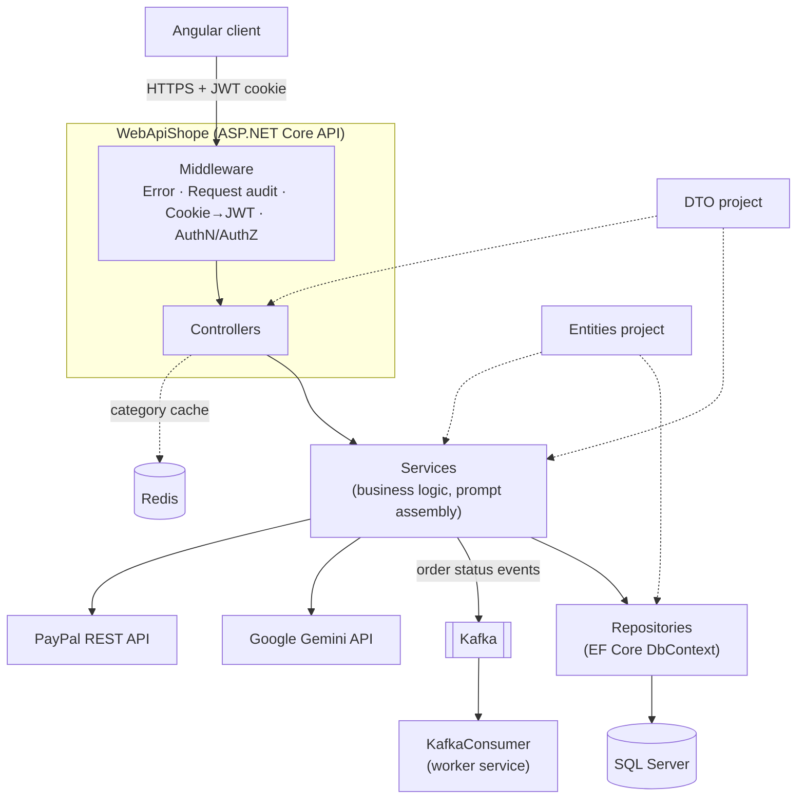

# Prompt Shop — Server

[](https://dotnet.microsoft.com/)
[](https://learn.microsoft.com/dotnet/csharp/)
[](https://learn.microsoft.com/ef/core/)
[](https://www.microsoft.com/sql-server)
[](https://redis.io/)
[](https://kafka.apache.org/)
[](https://ai.google.dev/)
[](https://developer.paypal.com/)
[](https://docs.docker.com/compose/)
[](https://xunit.net/)

An ASP.NET Core 9 REST API for an **AI website-builder prompt store**.

Users configure the website they want (site type, user-role platform and a catalog of features), pay with PayPal, and get back **one structured prompt** they can paste into an AI website builder such as Bolt.new or Google AI Studio. Every catalog product holds a pre-written prompt snippet. The server joins the snippets of an order into a complete specification for the AI builder.

This repository contains the backend only. A separate Angular client consumes it; CORS in `Program.cs` is set up for that client.

---

## Table of Contents

- [How It Works](#how-it-works)
- [Key Features](#key-features)
- [Tech Stack](#tech-stack)
- [Architecture](#architecture)
- [Getting Started](#getting-started)
- [Configuration](#configuration)
- [API Overview](#api-overview)
- [Usage Examples](#usage-examples)
- [Running Tests](#running-tests)

---

## How It Works

1. **Configure a site.** The user creates a *Basic Site* by choosing a **Site Type** and a **Platform**. A platform is a set of user roles (for example Admin, Secretary or Accountant) that the generated application should support.
2. **Build a cart.** The user browses a three-level catalog (**Main Category → Category → Product**) with search, price filters, sorting and paging. Each product is one website feature with its own prompt snippet.
3. **Fill gaps with AI.** If a feature is missing from the catalog, the user describes it in plain language. Google Gemini turns the description into a technical specification, which is stored and attached to the cart.
4. **Pay.** The server recalculates the order total from database prices, creates a PayPal order, and captures it before the order is saved.
5. **Get the prompt.** `CreatePrompt` walks the order grouped by main category, then category, then product. It joins the snippets with section headers, the platform's role architecture and the site's identity into one prompt.

---

## Key Features

| Area | What the code does |
|---|---|
| **Prompt assembly** | `Services/CreatePrompt.cs` builds the final prompt from the order items, the Basic Site, the Site Type, the Platform and any Gemini-generated specifications. |
| **Gemini integration** | `Services/gemini.cs` uses the `Google.GenAI` SDK to generate technical specifications for a custom product, a category or a basic site. `Services/ChatBot.cs` is a stateless sales/support chat assistant. The client sends its own history, and the server keeps only the last 11 messages. |
| **PayPal checkout** | `Services/PayPalService.cs` uses OAuth client credentials, checks the client-supplied amount against database prices (1-cent tolerance), then creates and captures the order through the PayPal REST API. |
| **Authentication** | JWT (HMAC-SHA256) is issued at login and stored in an `HttpOnly`, `Secure` cookie. `CookieTokenMiddleware` copies the cookie into the `Authorization` header so the standard JWT bearer handler can validate it. |
| **Authorization** | `[Authorize]` protects user endpoints. A custom `[AdminOnly]` attribute requires the `admin` role claim. |
| **Password security** | Passwords are hashed with BCrypt. Registration and password updates check strength with `zxcvbn` (score ≥ 2), and `POST /api/Password` exposes the strength check. |
| **Redis caching** | Paged category lists are cached in Redis with a configurable TTL. A version key per main category invalidates the cache after create, update or delete. If Redis is unavailable, requests go straight to the database. |
| **Event streaming** | When an admin updates an order's status, `OrdersServise` publishes a JSON event to Kafka. A separate `KafkaConsumer` worker service reads and logs these events. |
| **Request auditing** | `RatingMiddleware` stores every request (host, path, method, referer, user agent, timestamp) in the `Ratings` table. |
| **Error handling** | `ErrorMiddleware` logs unhandled exceptions and returns a consistent JSON `500` response. |
| **Reviews with images** | Reviews are submitted as `multipart/form-data` with an optional image, which is saved under `wwwroot/reviews`. |
| **Logging** | NLog with file and e-mail (MailKit) targets. |
| **Containerization** | Multi-stage Dockerfile running as a non-root user, plus a Docker Compose stack: SQL Server, Redis, Kafka (KRaft), Kafka UI, the consumer and the API. |

---

## Tech Stack

| Category | Technology |
|---|---|
| Language / runtime | C#, .NET 9 |
| Web framework | ASP.NET Core Web API, OpenAPI + Swagger UI (Swashbuckle) |
| Data access | Entity Framework Core 9 (SQL Server provider), database-first via EF Core Power Tools |
| Database | Microsoft SQL Server |
| Cache | Redis (`StackExchange.Redis`) |
| Messaging | Apache Kafka (`Confluent.Kafka`) |
| AI | Google Gemini (`Google.GenAI`) |
| Payments | PayPal REST API (typed `HttpClient`) |
| Auth & security | JWT bearer, BCrypt.Net-Next, zxcvbn-core |
| Mapping | AutoMapper |
| Logging | NLog (`NLog.Web.AspNetCore`, `NLog.MailKit`) |
| Testing | xUnit, Moq, MockQueryable.Moq, FluentAssertions, EF Core InMemory |
| DevOps | Docker, Docker Compose |

---

## Architecture

The solution uses a layered (N-tier) architecture. Each layer is its own project and talks only to the layer below it through interfaces registered in ASP.NET Core's built-in dependency-injection container.



### Projects

| Project | Responsibility |
|---|---|
| `WebApiShope` | API host: `Program.cs` (DI, auth, CORS, pipeline), controllers, middleware, `[AdminOnly]` attribute, static files (`wwwroot`) |
| `Services` | Business logic, validation, AutoMapper profile, prompt builder, and the Gemini, PayPal, JWT, password and Kafka producer services |
| `Repositories` | Data access: `MyShop330683525Context` (EF Core) and one repository per aggregate |
| `Entities` | EF Core entity classes mapped to database tables |
| `DTO` | Request/response contracts, the `Resulte<T>` result wrapper and the `ResponePage<T>` pagination wrapper |
| `KafkaConsumer` | Standalone .NET worker that subscribes to the order-events topic |
| `Tests` | xUnit unit tests (mocked `DbContext`) and integration tests (EF Core InMemory) for the repositories |

### Folder Structure

```
.
├── README.md
└── WebApiShope/
    ├── WebApiShope.sln
    ├── docker-compose.yml          # SQL Server, Redis, Kafka, Kafka UI, consumer, API
    ├── Dockerfile                  # Multi-stage build for the API
    ├── .env.example                # Variables used by docker-compose (names only)
    ├── redis/redis.conf.template
    ├── WebApiShope/                # API host
    │   ├── Controllers/
    │   ├── MiddleWare/
    │   ├── Attributes/
    │   ├── wwwroot/                # Category images and uploaded review images
    │   ├── nlog.config
    │   └── Program.cs
    ├── Services/
    ├── Repositories/
    ├── Entities/
    ├── DTO/
    ├── KafkaConsumer/
    └── Tests/
```

---

## Getting Started

### Prerequisites

- [.NET 9 SDK](https://dotnet.microsoft.com/download/dotnet/9.0)
- SQL Server with the shop database schema (see [Database](#database))
- Redis
- Kafka (needed for order-status updates)
- A Google Gemini API key
- PayPal developer (sandbox) credentials
- *or* Docker and Docker Compose to run the infrastructure in containers

### Option A: Docker Compose

```bash
cd WebApiShope
cp .env.example .env      # then fill in your own values
docker compose up --build
```

| Service | URL / port |
|---|---|
| API | http://localhost:8080 |
| Kafka UI | http://localhost:8081 |
| SQL Server | `localhost:1433` |
| Redis | `localhost:6379` |
| Kafka broker | `localhost:9092` |

> **Note:** `docker-compose.yml` does not set the `Jwt__*` or `Kafka__*` variables for the `api` service. Provide them yourself (for example in an `appsettings.json` or an override file). Without them, login and order-status updates will fail. See [Configuration](#configuration).

### Option B: Run locally with the .NET CLI

```bash
cd WebApiShope
dotnet restore
dotnet build
dotnet run --project WebApiShope
```

The `http` launch profile listens on `http://localhost:5104` (`https` profile: `https://localhost:7075`). In the `Development` environment, Swagger UI is at `/swagger` and the OpenAPI document is at `/openapi/v1.json`.

### Database

The data layer is **database-first**: the entities and `MyShop330683525Context` were scaffolded from an existing SQL Server database with EF Core Power Tools (`Repositories/efpt.config.json`). The repository contains **no EF migrations and no SQL scripts**, so you need to create the schema (`MyShop330683525`) before the API can serve data.

---

## Configuration

Configuration is read in this order (later sources override earlier ones): `appsettings.json` → `appsettings.{Environment}.json` → environment variables → command-line arguments. Both `appsettings*.json` files are git-ignored, so supply settings through one of them or through environment variables. ASP.NET Core uses `__` (double underscore) as the section separator in environment variable names.

| Variable | Used by | Purpose |
|---|---|---|
| `ConnectionStrings__DefaultConnection` | API | SQL Server connection string |
| `Jwt__SecretKey` | API | HMAC signing key for JWTs |
| `Jwt__Issuer` | API | JWT issuer |
| `Jwt__Audience` | API | JWT audience |
| `Jwt__ExpiresHours` | API | Token and cookie lifetime (default `6`) |
| `AdminName` | API | E-mail of the admin account (gets the `admin` role at login) |
| `AdminPassword` | API | Password of the admin account |
| `Redis__ConnectionString` | API | Redis connection (default `localhost:6379`) |
| `CategoryCache__TtlSeconds` | API | Category cache TTL (default `120`) |
| `Kafka__BootstrapServers` | API, KafkaConsumer | Kafka brokers |
| `Kafka__Topic` | API, KafkaConsumer | Topic for order-status events |
| `Kafka__GroupId` | KafkaConsumer | Consumer group (default `webapishope-kafka-consumer`) |
| `GEMINI_API_KEY` | API | Google Gemini API key |
| `PayPal__ClientId` | API | PayPal REST client ID |
| `PayPal__ClientSecret` | API | PayPal REST client secret |
| `PayPal__BaseUrl` | API | PayPal endpoint, e.g. the sandbox URL |
| `IMAGES_CATEGORIES_PATH` | API | Base URL prefixed to category image file names |
| `RateLimiting__AnonymousLimit` / `__AuthenticatedLimit` / `__WindowSeconds` | API | Options for the Redis rate limiter (the middleware is currently commented out in `Program.cs`) |

Docker Compose reads these values from `WebApiShope/.env`. Copy them from [`WebApiShope/.env.example`](WebApiShope/.env.example):

```
SA_PASSWORD=
REDIS_PASSWORD=
GEMINI_API_KEY=
PAYPAL_CLIENT_ID=
PAYPAL_CLIENT_SECRET=
ADMIN_NAME=
ADMIN_PASSWORD=
```

---

## API Overview

All routes have the `/api` prefix. 🔒 = requires an authenticated user, 🛡️ = requires the `admin` role.

| Resource | Endpoints |
|---|---|
| **Users** | `GET /Users?userName=` (does the user name exist?) · `GET /Users/{id}` · `POST /Users` (register) · `POST /Users/loginFunction` · `POST /Users/signInWithGoogle` · `POST /Users/logout` · `PUT /Users/{id}` 🔒 · `GET /Users/isAdmin/{id}` |
| **Password** | `POST /Password` (zxcvbn strength score) |
| **Site types** | `GET /SiteTypes` · `GET /SiteTypes/{id}` · `PUT /SiteTypes/admin/{id}` 🛡️ · `DELETE /SiteTypes/admin/{id}` 🛡️ |
| **Platforms** | `GET /Platforms` · `POST` / `PUT /{id}` / `DELETE /{id}` 🛡️ |
| **Basic sites** | `GET /BasicSite/{id}` · `POST /BasicSite` · `PUT /BasicSite/{id}` |
| **Main categories** | `GET /MainCategories` · `POST /MainCategories/admin` 🛡️ · `PUT` / `DELETE /MainCategories/admin/{id}` 🛡️ |
| **Categories** | `GET /Categories` (paged, searchable, Redis-cached) · `GET /Categories/{id}` · `POST` / `PUT /{id}` / `DELETE /{id}` 🛡️ |
| **Products** | `GET /Products` (paged, search, price filter, sort) · `GET /Products/all` · `POST` / `PUT /{id}` / `DELETE /{id}` 🛡️ |
| **Cart** 🔒 | `GET /CartsItems` · `GET /CartsItems/{id}` · `POST /CartsItems` · `DELETE /CartsItems/{id}` · `PUT /CartsItems/changeToValid/{id}` · `PUT /CartsItems/changeToNotValid/{id}` |
| **Gemini** 🔒 | `POST /Gemini/userProduct` · `POST /Gemini/category` · `POST /Gemini/basicSite` · `GET /Gemini/{id}` · `PUT /Gemini/{promptId}/userProduct` · `PUT /Gemini/{promptId}/basicSite` · `PUT /Gemini/{promptId}/category` · `DELETE /Gemini/{id}` |
| **Payments** 🔒 | `POST /Payments/create` · `POST /Payments/capture/{paypalOrderId}` |
| **Orders** | `POST /Orders` 🔒 · `GET /Orders/{id}` 🔒 · `GET /Orders/userID/{id}` 🔒 · `GET /Orders/{orderId}/orderItems` 🔒 · `POST /Orders/{orderId}/prompt` 🔒 · `GET /Orders/admin` 🛡️ · `PUT /Orders/{id}` 🛡️ (status update → Kafka event) |
| **Reviews** | `GET /Review?limit=&currentPage=` · `GET /Review/{id}` · `POST /Review` (multipart) · `PUT /Review/{id}` |
| **Chat** | `POST /Chat` |

---

## Usage Examples

JSON property names are camelCase (ASP.NET Core default). The values below are illustrative.

### Log in

```http
POST /api/Users/loginFunction
Content-Type: application/json

{
  "userName": "jane@example.com",
  "userPassward": "S0me-Strong-Passw0rd"
}
```

```http
HTTP/1.1 201 Created
Set-Cookie: access_token=<jwt>; HttpOnly; Secure; SameSite=None
Location: /api/Users/42

{
  "userID": 42,
  "userName": "jane@example.com",
  "firstName": "Jane",
  "lastName": "Doe",
  "phone": "0500000000",
  "basicID": 7
}
```

Later requests from the browser send the cookie automatically. `CookieTokenMiddleware` copies it into the `Authorization: Bearer` header.

### Browse products (paged and filtered)

```http
GET /api/Products?categoryID=3&numOfPages=1&PageSize=10&search=login&minPrice=0&MaxPrice=100&orderByPrice=true&desc=false
```

```json
{
  "data": [
    {
      "productsID": 15,
      "categoryID": 3,
      "productsName": "Login page with password reset",
      "categoryName": "Authentication",
      "imgUrl": "Auth_Login_Main.jpg",
      "price": 12.5
    }
  ],
  "totalItems": 1,
  "pageSize": 10,
  "currentPage": 1,
  "hasPreviousPage": false,
  "hasNextPage": false
}
```

The endpoint returns `204 No Content` when nothing matches.

### Create a verified PayPal order 🔒

```http
POST /api/Payments/create
Content-Type: application/json

{
  "clientAmount": 12.50,
  "currency": "USD",
  "products": [
    { "userID": 42, "productsID": 15, "platformsID": 2, "productName": "Login page with password reset", "price": 12.5 }
  ]
}
```

```json
{ "id": "5O190127TN364715T" }
```

The server sums the product prices from the database. If the client's amount differs by more than one cent, it returns `400` with `{ "error": "Amount mismatch: ..." }`.

### Generate the final prompt 🔒

```http
POST /api/Orders/1024/prompt
```

```text
# SYSTEM INSTRUCTION: ALL-IN-ONE FULL STACK ENGINE

You are a highly advanced full-stack web developer acting as a Strict Compiler. ...

## 1. CORE OPERATIONAL LAWS (TOP PRIORITY)
...
```

### Chat assistant

```http
POST /api/Chat
Content-Type: application/json

{
  "history": [
    { "role": "user",  "text": "What do I get after paying?" },
    { "role": "model", "text": "You receive a complete prompt ..." }
  ],
  "newMessage": "Which AI tools can I paste it into?"
}
```

The response body is the assistant's reply as a plain string.

---

## Running Tests

The `Tests` project has about 80 xUnit tests for the users, orders, categories and main categories repositories:

- **Unit tests** (`*UnitTest.cs`) mock `MyShop330683525Context` with Moq / MockQueryable.
- **Integration tests** (`*IntegrationTest.cs`) run against an EF Core **InMemory** database seeded by fixtures.

The tests don't need SQL Server, Redis or Kafka.

```bash
cd WebApiShope
dotnet test
```

Run only one kind:

```bash
dotnet test --filter "FullyQualifiedName~UnitTest"
dotnet test --filter "FullyQualifiedName~IntegrationTest"
```
